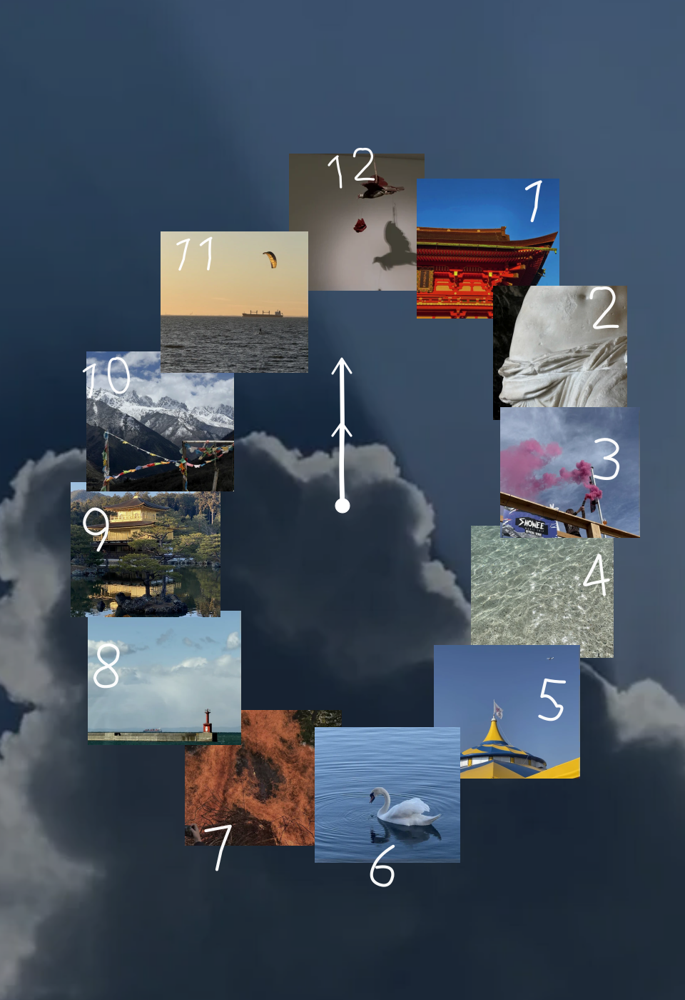

# Time, collected — moving-cloud photo clock

**[▶ OPEN THE LIVE CLOCK ↗](https://dongcoco.github.io/DonGCoco/swan-photo-clock/live.html?v=5)** — uses **your device's local time**, including a moving seconds hand.

The preview above is an **animated SVG preview** with gentle cloud drift and moving illustrative hands. On the linked website, your original cloud video plays behind 12 flat, overlapping photographs. The image at 12 o'clock is now the suspended bird artwork, not the same cloud photo as the background. The 6 o'clock image is the swan photograph.

**Why a link?** GitHub READMEs do not execute JavaScript, so they cannot display a live clock synchronized to each viewer's device. Only the linked webpage can do that. The README animation is an illustrative motion preview, not a real-time clock.

On an iPhone, if Low Power Mode, the browser, or in-app webview stops autoplay, the live page displays **“Tap to play moving clouds ▷”**. Tap it once to start the video.

## Running locally

Serve the folder, for example with `python3 -m http.server 8000`, and open `http://localhost:8000/live.html`. The JavaScript clock hands use `new Date()` and update continuously.

## Art direction

- 12 photographs selected for visual harmony rather than calendar order.
- A connected, organically overlapping ring of **flat rectangular photographs** (no frames, bevels, or shadows).
- Deep, muted blue-gray clouds serve as moving atmosphere; warm red, amber, and pink images provide contrast.
- Minimal white single-stroke hand-drawn numbers and watch hands.
- The README uses an animated SVG preview with the updated smaller handwriting; the web page uses the real moving video and current computer/phone time.