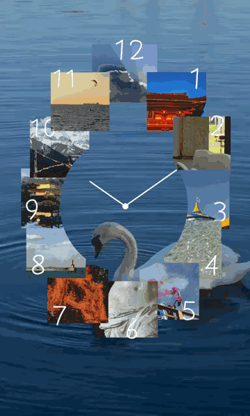

# A Clock Made of Photographs

**[Open the live clock ↗](https://DonGCoco.github.io/DonGCoco/swan-photo-clock/)** · Automatically uses **your device's local time**.

Twelve original photographs, composed as a single connected and overlapping ring over a real moving swan video. Flat square photo edges, no frames or drop shadows, custom white single-stroke handwritten numerals, and white ink-style hour/minute hands.

> **GitHub README limitation:** GitHub's Markdown renderer strips JavaScript and iframes. Therefore, this README shows an animated representative preview, but it **cannot display a clock synchronized to each viewer's computer**. The linked HTML page is the actual working real-time clock.

## Run locally

Open `index.html` in a modern browser, or for maximum browser compatibility run `python3 -m http.server 8000` in the project folder, then open `http://localhost:8000`.

## Publish with GitHub Pages

In your repository, open **Settings → Pages → Build and deployment**, choose **Deploy from a branch** and select the branch/folder that contains `index.html`. The live URL updates automatically when the source is published. If deploying this project from a subdirectory, ensure the URL points to that subdirectory.

## Visual brief / design rules

- Twelve flat cropped photographs physically touch or overlap to create one unmistakable *continuous ring*. Adjacent tile edges overlap about 10–25% where needed. Uneven tile sizes, staggered edges and unframed hard cuts reproduce the casual cut-and-paste character.
- A clear center is reserved for a small, unpolished ink-drawn pair of clock hands. No dial outline, shadows, gradients, raised effects, faux tape, Polaroid borders or 3D styling.
- Numbers 1–12 are handwritten in thin irregular white lines, on or across the tiles. No serif, calligraphy, brush-lettering or geometric digital clock font.
- The original animated swan water is the full-bleed background; the quiet cool blue becomes the dominant color. Balanced accent intervals of saffron yellow, fire orange, temple red and smoke pink create a rhythm without overstimulating.
- Clock runs on `new Date()` in JavaScript, refreshed with `requestAnimationFrame`, so hour and minute hands track the viewer's own device clock and time zone.

Assets used with permission of the original uploader; no stock photographs and no AI-recreated photography.